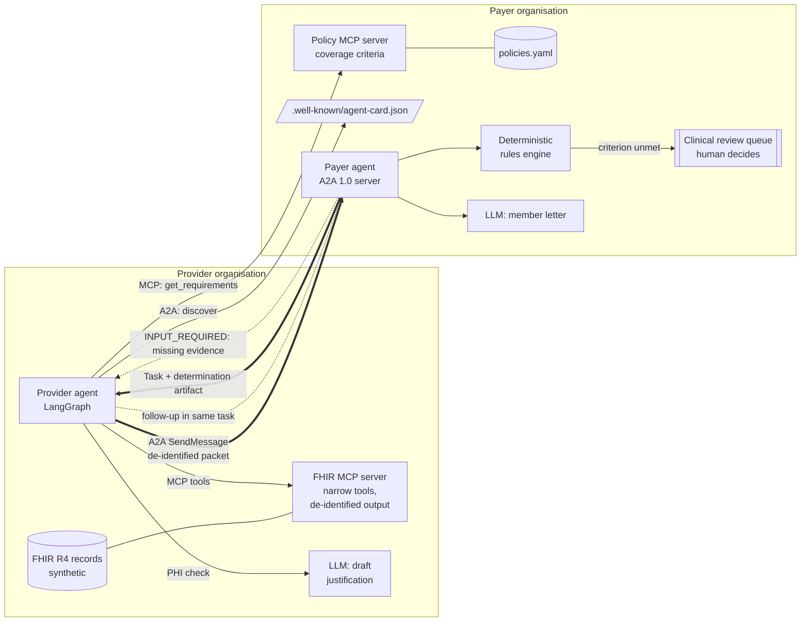

# Prior Authorization Agents: MCP + A2A for Healthcare

Two organisations' AI agents settle a prior-authorization request without a fax, a phone call or a portal:

- a **provider agent** (clinic) collects the minimum necessary evidence from the patient record through a **FHIR MCP server**
- a **payer agent** (health plan) receives it over the **A2A 1.0** agent-to-agent protocol, checks it against published policy and returns a determination

Between them sit **PHI controls**, a **deterministic rules engine**, a **human clinical-review queue** and a full **audit trail**.

[](https://github.com/kribalaji/prior-auth-agents/actions/workflows/ci.yml)


-E8590C)

> **All patients, plans and policies in this repository are fictional.** The coverage criteria exist only to exercise the software. They are not clinical guidance.

---

## Why this problem

Prior authorization is one of the most manual workflows in healthcare: clinicians gather records, payers check criteria, and requests bounce back and forth for missing information. In the US, the CMS Interoperability and Prior Authorization final rule (CMS-0057-F) requires impacted payers to offer an electronic **Prior Authorization API**, with compliance dates beginning January 1, 2027. The rule also requires payers to give a specific reason when they deny a request.

This project explores what that exchange looks like when **both sides are agents**, and which controls keep it safe:

| Risk | Control in this project |
|---|---|
| An LLM "decides" coverage | Coverage is decided by a **deterministic rules engine** (`rules.py`). The LLM only drafts the justification and the member letter. |
| Automated denials | An unmet criterion is **never denied automatically**. It is routed to a **human clinical reviewer** (`/review-queue`). |
| Over-sharing PHI | The FHIR MCP server exposes **narrow, criterion-specific tools**, not a generic query. Outbound data uses **keyed pseudonyms**, age instead of birth date, and day offsets instead of dates. |
| PHI reaching a model or another organisation | Every LLM prompt, LLM output and A2A payload passes a **PHI leak check**. A leak blocks the step, and the error never repeats the leaked value. The payer also **rejects** any request that contains direct identifiers. |
| No accountability | **Append-only audit log** with payload hashes on both sides, including the reviewing clinician's decision. |

## Architecture



### Request lifecycle

1. **requirements**: the provider agent asks the payer's **policy MCP server** what the service needs. If no policy exists, it stops **before touching patient data**.
2. **patient_context**: the FHIR MCP server returns a pseudonymous member reference, age and sex. Name, MRN, birth date and contact details never leave the server.
3. **gather_evidence**: for each criterion, one targeted MCP call (`find_observations(loinc=4548-4, within_days=180)` and so on). Nothing else is fetched.
4. **draft_justification**: the LLM (or the offline template) writes a short justification from the de-identified evidence. Both the prompt and the output are PHI-checked.
5. **submit**: the agent discovers the payer through its **Agent Card** and sends the packet with A2A `SendMessage`.
6. **payer decision**: the rules engine evaluates every criterion as `met`, `not_met` or `missing_evidence`.

| Rules result | Outcome | A2A task state |
|---|---|---|
| all criteria met, or a red-flag bypass | `approved` | `COMPLETED` |
| something is missing | `pended_more_information` | `INPUT_REQUIRED`; the provider can **reply in the same task** with more evidence |
| a criterion is not met | `routed_to_clinical_review` | `COMPLETED`, with a review ticket; a clinician decides |
| no policy, invalid payload, or direct identifiers | rejected | `REJECTED` |

## Results

These numbers come from this repository's own commands.

**Scenario run** (`make demo`): 12 synthetic patients across 3 policies (GLP-1 for type 2 diabetes, lumbar MRI, a biologic for rheumatoid arthritis). **12/12** outcomes match the expected ground truth in [`evals/scenarios.yaml`](evals/scenarios.yaml): 6 approved (one through the red-flag bypass), 2 pended for missing labs, and 4 routed to clinical review.

```
patient  service      A2A state       outcome                     expected
P001     GLP1-T2D     completed       approved                    ✓
P002     GLP1-T2D     input_required  pended_more_information     ✓
P003     GLP1-T2D     completed       routed_to_clinical_review   ✓
P007     MRI-LSPINE   completed       approved                    ✓   (cauda equina red flag)
...
12/12 as expected; 4 case(s) in the clinical review queue
```

**Tests** (`make test`, 35 tests) cover:
- the rules engine: thresholds, stale labs counted as missing, latest result wins, `any_of`, bypass
- PHI controls: keyed pseudonyms, the leak detector, and MCP outputs free of identifiers
- every scenario end to end over real MCP and A2A
- **a check that no direct identifier of any patient appears in any LLM prompt or any A2A request**
- a leaking LLM output is blocked before anything reaches the payer
- the payer rejects packets containing an MRN
- a multi-turn A2A follow-up turns a pended request into an approval
- the human review-queue decision is audited

## Quick start

Requires Python 3.11+ and [uv](https://docs.astral.sh/uv/). No API key or GPU is needed. Text drafting falls back to a deterministic template.

```bash
git clone https://github.com/kribalaji/prior-auth-agents.git
cd prior-auth-agents
make setup
make test          # 35 tests
make demo          # 12 scenarios end to end
uv run priorauth submit P002 GLP1-T2D    # trace, justification, determination, letter
```

To use a real model for the justification and letter:

```bash
export PA_LLM_PROVIDER=anthropic ANTHROPIC_API_KEY=...    # or PA_LLM_PROVIDER=gemini GEMINI_API_KEY=...
uv run priorauth demo
```

To run the payer as a real A2A service:

```bash
make payer                                   # http://localhost:9100
curl localhost:9100/.well-known/agent-card.json
curl localhost:9100/review-queue
```

The MCP servers also run standalone over stdio (`python -m priorauth.mcp_fhir`, `python -m priorauth.mcp_policy`), so any MCP host can connect to them.

## Repository layout

```
policies/policies.yaml     fictional coverage criteria (machine-readable)
data/fhir/                 12 synthetic FHIR R4 bundles (generated by data_gen/build_fhir.py)
src/priorauth/
  mcp_fhir.py              provider FHIR MCP server: narrow, de-identified tools
  mcp_policy.py            payer policy MCP server
  provider_agent.py        LangGraph workflow, MCP clients, A2A client
  payer_agent.py           A2A 1.0 server, agent card, review queue
  rules.py                 deterministic criteria evaluation
  phi.py                   pseudonymisation and leak detection
  audit.py                 append-only audit log
  llm.py                   Anthropic, Gemini, offline template and test providers
evals/scenarios.yaml       ground-truth outcome per patient
tests/                     rules, PHI/MCP and end-to-end tests
docs/adr/                  design decisions
```

## Limitations

This is a reference implementation for learning and demonstration, **not** a compliant prior-authorization system.

- It does not implement the HL7 Da Vinci CRD, DTR or PAS implementation guides, or X12 278. A production system would carry FHIR `Claim` and `ClaimResponse` resources defined by those guides.
- There is no authentication between agents yet. Production needs OAuth 2.0 or mTLS on A2A and MCP, and **signed agent cards**.
- The task store, review queue and audit log are in memory. Production needs durable stores and push notifications so the provider learns the reviewer's final decision.
- The policies are illustrative, and real medical policies are far richer. Pseudonymisation is keyed HMAC, not a full de-identification standard such as HIPAA Safe Harbor review.

## License

MIT. All data is synthetic and every name is invented.
